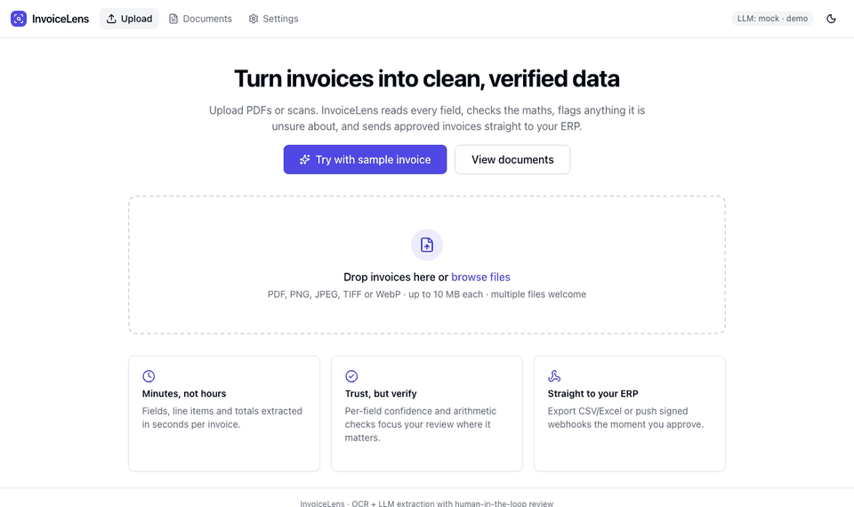
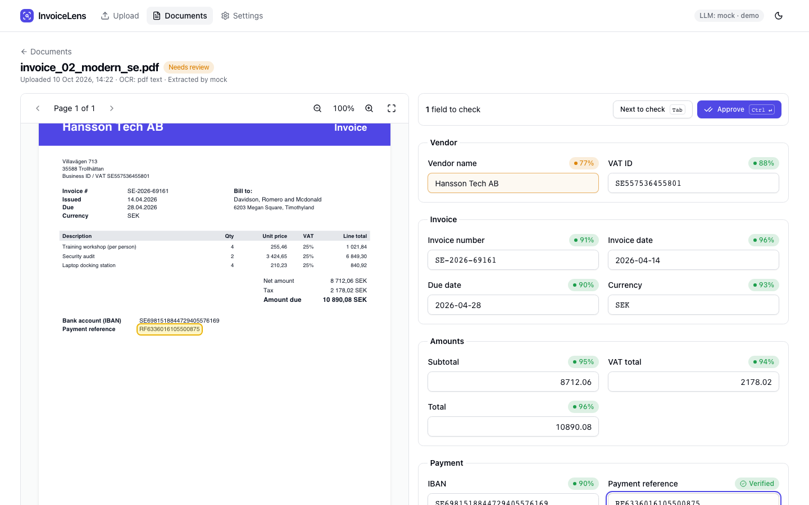
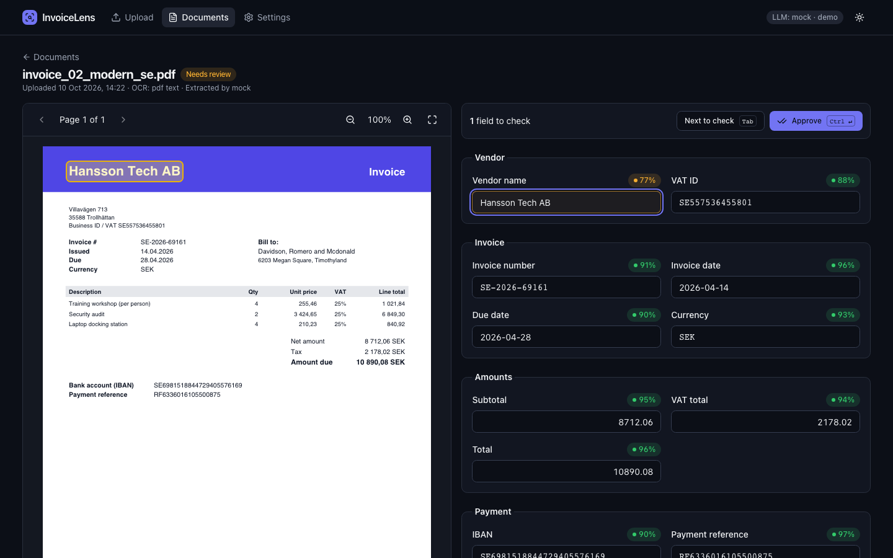
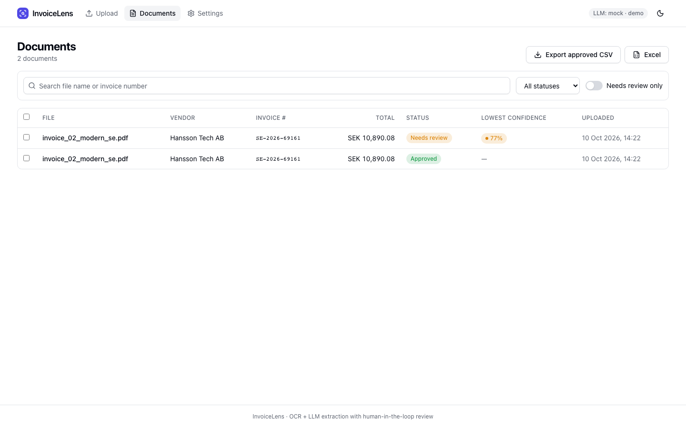
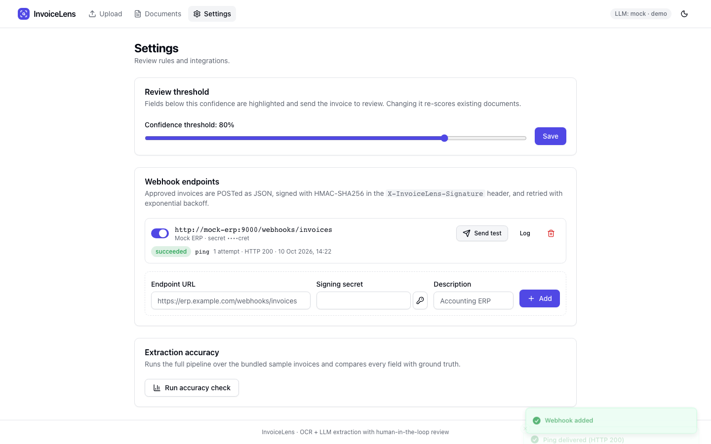
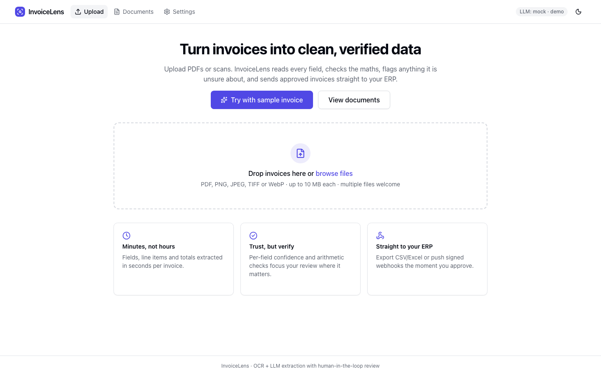
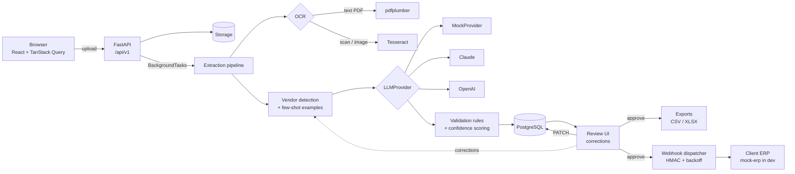

<div align="center">

# InvoiceLens

**AI invoice extraction with a human in the loop: upload PDFs or scans, review only the fields that need you, and push clean data to your ERP.**

[](https://github.com/weblinkify/Invoice-lens/actions/workflows/ci.yml)


[](LICENSE)

[**Live demo**](https://invoicelens-indol.vercel.app) · [Quick start](#quick-start) · [Architecture](#architecture) · [Accuracy](#accuracy)



</div>

> **No API keys needed.** The whole app (dev, tests, CI and the demo) runs on a deterministic mock LLM and generated invoices. Set one environment variable to switch to Claude or OpenAI.

---

## The problem

Accounts-payable teams still re-type invoices into their ERP: vendor, dates, VAT IDs, IBANs, line items, totals. At 3–5 minutes per invoice, 1,000 invoices a month is roughly **60–80 hours of manual data entry**, and typos in an IBAN or a total cost real money.

Fully automatic OCR tools don't fix this. They are confidently wrong just often enough that someone has to check every invoice anyway.

## The solution

InvoiceLens extracts every field, **checks its own work**, and asks a human only about what it isn't sure of:

1. **Extract**: OCR (text layer or Tesseract for scans) feeds an LLM, which fills a strict schema.
2. **Verify**: business rules recompute the maths (lines → subtotal → VAT → total), validate IBAN checksums and FI/SE/DE VAT IDs, and lower the confidence of anything that doesn't add up.
3. **Review**: a split-screen view highlights low-confidence fields on the original document. Press <kbd>Tab</kbd> to jump between them and <kbd>Ctrl</kbd>+<kbd>Enter</kbd> to approve.
4. **Learn**: corrections are stored per vendor and fed back as few-shot examples, so the same mistake isn't made twice.
5. **Deliver**: export CSV/Excel, or push a signed webhook to your ERP the moment an invoice is approved.

A reviewer typically confirms 1–3 highlighted fields instead of re-typing 15+ fields and every line item.

## Screenshots

| Review: PDF with bbox highlight + confidence chips | Dark mode |
| --- | --- |
|  |  |

| Documents list with bulk export | Settings: threshold, webhooks, accuracy |
| --- | --- |
|  |  |

<details>
<summary>Upload page</summary>



</details>

Screenshots are produced by the Playwright E2E suite (`make e2e`), so they always show the real app.

## Features

**Extraction**
- PDF text layer via `pdfplumber`, with automatic **Tesseract OCR fallback** for scans and images (PNG/JPEG/TIFF/WebP)
- Pluggable LLM layer: **MockProvider** (default, deterministic), **Claude** (`claude-opus-5-5`, reads the PDF directly with structured outputs) or **OpenAI**
- Strict Pydantic schema: every field carries `value`, `confidence`, `source_page` and a normalized `bbox`
- Vendor memory: reviewer corrections become **few-shot examples** for that vendor's next invoice

**Validation and confidence**
- Line items sum to the subtotal, subtotal + VAT = total, quantity × unit price = line total (±0.01)
- Due date on or after invoice date; IBAN mod-97; VAT ID checksums for 🇫🇮 🇸🇪 🇩🇪; ISO 4217 currencies
- Failed rules lower the confidence of the fields involved; a configurable threshold decides `needs_review`

**Review UI**
- PDF viewer (zoom, paging) with a **highlight box on the focused field**
- Green / amber / red confidence chips, inline validation messages, "verified" state
- Keyboard-first: <kbd>Tab</kbd> next field to check, <kbd>Enter</kbd> confirm, <kbd>Ctrl</kbd>+<kbd>Enter</kbd> approve
- **"Try with sample invoice"** button for instant demos
- Responsive, accessible (labels, `aria-*`, skip link, focus rings), dark mode

**Integration**
- CSV and Excel (`.xlsx`, invoices + line-items sheets) export, protected against formula injection
- Webhooks signed with **HMAC-SHA256** (`X-InvoiceLens-Signature: t=…,v1=…`), retried with **exponential backoff**, full delivery log
- RFC 7807 `application/problem+json` errors, optional API-key auth, OpenAPI-generated TypeScript client

## Architecture



| Service | Tech | Port |
| --- | --- | --- |
| `frontend` | Vite + React 18 + TypeScript, Tailwind, shadcn/ui-style components, served by nginx (proxies `/api`) | 8080 |
| `backend` | FastAPI, Pydantic v2, SQLAlchemy 2 + Alembic, Tesseract | 8000 |
| `postgres` | PostgreSQL 16 | internal |
| `mock-erp` | Tiny FastAPI app that verifies webhook signatures and records deliveries | 9000 |

## Accuracy

Field-level accuracy over the 10 generated fixture invoices (3 layouts, EUR/SEK/USD, FI/SE/DE vendors, including a totals mismatch, a missing due date, a **rotated scanned image** and a **multi-page** invoice). Generate it yourself with `make accuracy`, or `GET /api/v1/metrics/accuracy` for the configured provider.

| Field | MockProvider (default) | OCR + heuristics only |
| --- | ---: | ---: |
| `vendor_name` | 100.0% | 100.0% |
| `vendor_vat_id` | 80.0% | 90.0% |
| `invoice_number` | 80.0% | 100.0% |
| `invoice_date` | 100.0% | 90.0% |
| `due_date` | 100.0% | 100.0% |
| `currency` | 100.0% | 100.0% |
| `subtotal` | 100.0% | 90.0% |
| `vat_total` | 100.0% | 90.0% |
| `total` | 100.0% | 90.0% |
| `iban` | 60.0% | 90.0% |
| `payment_reference` | 90.0% | 100.0% |
| `line_items.description` | 100.0% | 97.1% |
| `line_items.quantity` | 100.0% | 97.1% |
| `line_items.unit_price` | 100.0% | 97.1% |
| `line_items.vat_rate` | 100.0% | 97.1% |
| `line_items.line_total` | 100.0% | 97.1% |
| **All fields** | **98.0%** (446/455) | **96.5%** (439/455) |
| Routed to review | 100.0% | 100.0% |

How to read this honestly:
- **MockProvider** returns ground truth with deliberately injected, seeded **OCR-style errors** (`0→O`, `6→G`, swapped digits) and lowered confidence on one or two fields per invoice. Its job is to exercise the review UI. Every injected error is caught: it lands on a low-confidence field or fails a checksum rule, so it never passes unreviewed.
- **OCR + heuristics** is what runs when no LLM is configured and the document isn't a known fixture. It scores well here because the fixtures use a handful of templates. Real-world invoices need a real LLM (see below).
- "Routed to review" is 100% because every fixture deliberately contains something to check.

## Quick start

**Just want to click around?** The [live demo](https://invoicelens-indol.vercel.app) is the frontend built with `npm run build:demo`: the API runs in the browser via MSW (no backend, no data leaves your machine), so uploads return the canned sample extraction. Run the full stack below to extract your own invoices.

Requirements: Docker with Compose v2.

```bash
git clone https://github.com/weblinkify/Invoice-lens.git && cd Invoice-lens
cp .env.example .env          # optional, defaults work
docker compose up -d --build --wait
open http://localhost:8080    # click "Try with sample invoice"
```

Seed all 10 sample invoices and register the mock ERP webhook:

```bash
make demo
```

Ports already in use? Override them: `BACKEND_PORT=8001 FRONTEND_PORT=8081 docker compose up -d --wait`.

<details>
<summary>Local development without Docker</summary>

Requirements: Python 3.12 + [uv](https://docs.astral.sh/uv/), Node 22, optionally `tesseract` for scans.

```bash
make setup          # uv sync (backend, mock-erp), npm ci, pre-commit install
make dev            # API on :8000 (SQLite) + Vite on :5173 with /api proxy
make dev-mock       # frontend only, every API call answered by MSW mocks
```

</details>

## Configuration

All configuration comes from environment variables (see [`.env.example`](.env.example)).

| Variable | Default | Description |
| --- | --- | --- |
| `LLM_PROVIDER` | `mock` | `mock`, `anthropic` or `openai` |
| `ANTHROPIC_API_KEY` | — | Required when `LLM_PROVIDER=anthropic` |
| `ANTHROPIC_MODEL` | `claude-opus-5-5` | Claude model id |
| `OPENAI_API_KEY` | — | Required when `LLM_PROVIDER=openai` |
| `OPENAI_MODEL` | `gpt-4o-mini` | OpenAI model id |
| `LLM_TIMEOUT_SECONDS` | `60` | Per-request LLM timeout |
| `DATABASE_URL` | `sqlite:///backend/invoicelens.db` | SQLAlchemy URL (compose uses PostgreSQL) |
| `STORAGE_DIR` | `backend/storage` | Where uploaded files are stored |
| `MAX_UPLOAD_BYTES` | `10485760` | Upload limit (10 MB) |
| `OCR_ENGINE` | `auto` | `auto` (text layer, then Tesseract), `pdf`, `none` |
| `TESSERACT_CMD` | — | Custom path to the `tesseract` binary |
| `CONFIDENCE_THRESHOLD` | `0.8` | Initial review threshold (editable in Settings) |
| `FEWSHOT_MAX_EXAMPLES` | `3` | Corrected invoices per vendor fed to the LLM |
| `DEMO_MODE` | `true` | When `false`, `/api/v1` requires `X-API-Key` |
| `API_KEY` | — | The API key used when demo mode is off |
| `CORS_ORIGINS` | `["http://localhost:5173"]` | JSON list of allowed origins |
| `WEBHOOK_MAX_ATTEMPTS` | `5` | Delivery attempts before giving up |
| `WEBHOOK_BACKOFF_BASE_SECONDS` | `0.5` | Backoff: base × 2ⁿ (capped at 60 s) |
| `WEBHOOK_TIMEOUT_SECONDS` | `10` | Per-attempt HTTP timeout |
| `MOCK_SEED` | `42` | Seed for the mock provider's injected noise |
| `LOG_LEVEL` / `LOG_JSON` | `INFO` / `true` | Structured JSON logs to stdout |
| `MOCK_ERP_SECRET` | `demo-webhook-secret` | Shared secret mock-erp uses to verify signatures |
| `BACKEND_PORT` / `FRONTEND_PORT` / `MOCK_ERP_PORT` | `8000` / `8080` / `9000` | Host ports in docker compose |
| `VITE_API_BASE_URL` | same origin | Frontend build-time API base URL |

## Switching to a real LLM

```bash
# .env
LLM_PROVIDER=anthropic
ANTHROPIC_API_KEY=sk-ant-...
# optional: ANTHROPIC_MODEL=claude-sonnet-5-5  (cheaper)
```

then `docker compose up -d`. The Claude provider sends the **PDF itself** (or the image) plus the OCR text and vendor few-shot examples. It uses **structured outputs** to get schema-valid JSON and opts into server-side refusal fallbacks. Bounding boxes are added afterwards by matching values against the OCR word positions. `LLM_PROVIDER=openai` works the same way over the OCR text. Only the provider changes: validation, confidence scoring, review and webhooks stay the same.

## Testing

| Suite | Command | What it covers |
| --- | --- | --- |
| Backend unit + integration | `make test-backend` | 216 pytest tests, **≥ 85% coverage enforced** (currently ~97%): rules (parametrized), validators, confidence, MockProvider, OCR, CSV/XLSX contents, HMAC + retry/backoff (`respx`), few-shot builder, Alembic migrations, the full HTTP flow on SQLite, and an accuracy threshold over all fixtures |
| mock-erp | `cd mock-erp && uv run pytest` | Signature verification, `/fail-next`, reset |
| Frontend | `make test-frontend` | 86 Vitest + Testing Library tests with **MSW**, **≥ 80% coverage enforced** (currently ~96%): confidence chip, field editor, validation messages, dropzone, query/mutation hooks, review page (correct PATCH body, Tab/Enter/Ctrl+Enter, bbox highlight), settings |
| E2E | `make e2e` | Playwright against `docker compose`: upload → review → fix low-confidence field → approve → assert the exported CSV; few-shot reuse; webhook to mock-erp with **independent HMAC verification**; retry path via `POST /fail-next`; README screenshots |
| Demo smoke | `make e2e-demo` | Playwright against the static MSW build that Vercel serves: sample invoice → PDF preview renders → approve; SPA deep links return 200. `DEMO_URL=https://invoicelens-indol.vercel.app` runs it against the live demo |
| Lint / types | `make lint` | ruff, ruff format, `mypy --strict`, ESLint (strict type-checked), Prettier, `tsc` |

`make e2e` resets the documents in the compose stack, because learned corrections would otherwise make reruns non-deterministic.

CI (`.github/workflows/ci.yml`) runs the backend and frontend jobs in parallel (including a check that the generated API types match the OpenAPI schema), then the E2E jobs: the full flow on a fresh compose stack, and the demo smoke tests against the static build. Playwright reports, traces and compose logs are uploaded when it fails. Pushing a `v*` tag publishes multi-arch images to GHCR (`docker.yml`).

## Project structure

```
.
├── backend/
│   ├── app/
│   │   ├── api/            # routers (/api/v1), DTOs, dependencies
│   │   ├── core/           # settings, JSON logging, problem+json errors, API-key auth
│   │   ├── db/             # SQLAlchemy models + session
│   │   ├── domain/         # schema, IBAN/VAT validators, rules, confidence, few-shot builder
│   │   ├── llm/            # LLMProvider protocol, Mock / Anthropic / OpenAI, heuristics, prompt
│   │   ├── ocr/            # OcrEngine protocol, pdfplumber + Tesseract
│   │   └── services/       # pipeline, storage, exports, webhooks, accuracy, vendors
│   ├── alembic/            # migrations
│   ├── scripts/            # generate_invoices, seed_demo, accuracy_report, export_openapi
│   └── tests/              # unit/, integration/, fixtures/invoices (10 PDFs + truth.json)
├── frontend/
│   ├── src/
│   │   ├── api/            # generated schema.d.ts, typed client, TanStack Query hooks
│   │   ├── components/     # ui/ primitives, DocumentViewer, ReviewForm, FieldEditor, …
│   │   ├── pages/          # Upload, Documents, Review, Settings
│   │   ├── mocks/          # MSW handlers (Vitest + `npm run dev:mock`)
│   │   └── lib/            # field metadata, validation (zod), formatting
│   └── e2e/                # Playwright specs
├── mock-erp/               # fake ERP webhook receiver
├── sample-data/            # demo invoices (same as backend fixtures)
├── docs/screenshots/       # generated by the E2E suite
├── docker-compose.yml
└── Makefile
```

## Design decisions and trade-offs

**Why per-field confidence instead of a pass/fail?** Reviewers' time is the expensive resource. A single document-level score forces a full re-check. Per-field confidence combined with deterministic rules (checksums, arithmetic) pinpoints the 1–3 fields worth looking at. Rules matter more than the model's self-reported confidence: an LLM can be confidently wrong, but an IBAN checksum can't.

**Why a provider interface?** Extraction quality, cost and data-residency needs differ per client. `LLMProvider` is a one-method protocol, so Claude, OpenAI, a self-hosted model, or the deterministic mock plug in without touching validation, review or delivery. The mock makes the test suite and CI free, fast and reproducible.

**Why HMAC-signed webhooks with retries?** ERPs are the system of record, so they must be able to trust what arrives. The timestamped signature (`t=…,v1=…`) prevents tampering and replay. Exponential backoff rides out ERP downtime. 4xx responses (except 408/429) are not retried, because retrying can't fix them. Every attempt is logged per delivery.

**Why reuse corrections as few-shot examples?** Most invoice volume comes from a small set of recurring vendors with stable layouts, so a correction made once is very likely to apply again. Examples are scoped per vendor (matched by VAT ID, then name) and capped, which keeps prompts small.

**Why FastAPI `BackgroundTasks` instead of Celery?** It keeps a single deployable and no broker for a demo-sized workload. The pipeline is a plain `ExtractionPipeline.process(document_id)` call, so moving to Celery or RQ means wrapping that call in a task and replacing `background.add_task(...)` with `.delay(...)`. Documents already carry `queued/processing` states for a worker to pick up.

**Other trade-offs**: amounts are floats rounded to cents with a ±0.01 tolerance (simple JSON and TypeScript types; a `Decimal` migration would be needed for multi-currency accounting). Bounding boxes are normalized to 0..1 so the overlay works at any zoom. Uploads are validated by **magic bytes**, not the client's content type.

## Roadmap

- Multi-tenant organisations, users and SSO; per-tenant API keys and webhook secrets
- Celery/RQ workers with a durable queue, and webhook redelivery from the UI
- More document types: receipts, credit notes, purchase orders (PO matching)
- Line-item editing (add/remove rows) and per-vendor layout hints
- S3-compatible storage, virus scanning, retention policies
- Evaluation harness against real (anonymised) invoices and per-provider cost tracking

## Contributing

See [CONTRIBUTING.md](CONTRIBUTING.md). Conventions for AI-assisted work live in [CLAUDE.md](CLAUDE.md).

## License

[MIT](LICENSE)
